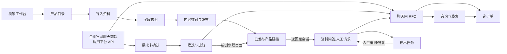

# MVP 逐页交互设计｜卖家系统与网页买方参考流程

**版本**：2026-10-03 · 首版可评审稿

**状态**：交互设计文档，不代表页面已开发或已通过用户测试。

**范围**：MVP 的卖家管理系统、标准聊天 API 所承载的网页买方业务动作、用于联调的参考聊天界面；标明 V1 接点。产品详情页的首屏、内容顺序、品类模板和具体版式留待单独调研，本文件只定义它与对话、RFQ 的交接。
**依据**：[MVP 需求](MVP-开发需求文档.md)、[完整客户旅程](完整客户旅程与界面验收.md)、[V1 需求](V1-完整功能开发需求文档.md)及现有[卖家概念线稿](../design/seller-console-wireframe/index.html)。若本文件的建议与正式需求冲突，以正式需求和用户最新决定为准。

## 1. 阅读方法和设计边界

- **已确认**：此前讨论明确的业务规则和交互方向，可用于实现验收。
- **设计建议**：本文件为让页面可以开发而补足的布局、反馈和操作细节；上线前应做一次低保真走查，不自动升级为用户已确认的产品范围。
- **待专题决定**：需要试点企业、买家测试或后续版本决定的内容，不用猜测值填空。

下文未明确标成「已确认」的具体控件、分栏方式、筛选和反馈文案，均按**设计建议**处理；开发时可在不改变正式需求的前提下通过走查调整。

平台卖给工业品企业的是**标准化聊天 API 与售前能力**。企业可把已有或自行开发的官网聊天窗口接入；平台不必为每家企业制作窗口。下文 B 页描述一个可用于联调和演示的**参考网页聊天界面**。其中的窗口尺寸、边框拖动和视觉方式不强制第三方窗口照做；需求确认、推荐证据、人工任务、RFQ 和会话权限等业务规则仍适用于接入方。

卖家系统参考用户提供的 Linear 深色截图的美术语言：深灰基底、克制边框、紧凑文字层级、少量强调色。**不复刻**其布局、品牌和内容。参考聊天界面与产品详情页不套用该截图。现有卖家 HTML 是概念线稿，含“模拟买家”按钮，不代表正式业务入口；正式产品的动作必须由真实界面和程序完成。

## 2. 页面地图与跨页接力

**另一条已确认路径**：买方已知型号时可直接打开公开产品链接，不经过需求卡和匹配，也可以直接提问或发起 RFQ。RFQ 入口在网页对话的任意阶段可用。产品详情页的公开资料不写入某位买家的私有工况；推荐理由留在私有会话中。

### 页面清单

| ID | 页面或状态区 | 主要使用者 | MVP 模块 | 本文详细程度 |
| --- | --- | --- | --- | --- |
| S00 | 登录、企业空间与全局框架 | 企业成员 | 基础权限 | 交互边界 |
| S01 | 今日工作台 | 管理员、产品负责人、销售、工程师 | M1–M7 | 逐页 |
| S02 | 产品目录 | 产品负责人、管理员 | M1、M2 | 逐页 |
| S03 | 导入资料与处理结果 | 产品负责人、管理员 | M1 | 逐页 |
| S04 | 字段、来源与缺项核对 | 产品负责人、管理员 | M1 | 逐页 |
| S05 | 内容核对、预览与发布 | 有发布权限的成员 | M2 | 逐页；不定义买方页面版式 |
| S06 | 客户咨询与线索详情 | 销售、工程师、获授权成员 | M3–M7 | 逐页 |
| S07 | 待答技术问题 | 售前工程师 | M5 | 逐页 |
| S08 | 询价队列与询价详情 | 销售、管理员 | M6、M7 | 逐页 |
| S09 | 成员与权限入口 | 管理员 | 基础权限 | MVP 最小交互 |
| B01 | 官网参考悬浮聊天窗口 | 买方 | M3–M6 | 逐页状态；可由企业自有前端替代 |
| B02 | 需求摘要卡 | 买方 | M3 | 聊天内状态 |
| B03 | 候选、比较与产品链接 | 买方 | M4 | 聊天内状态 |
| B04 | 有据问答与人工请求 | 买方 | M5 | 聊天内状态 |
| B05 | RFQ 填写与提交 | 买方 | M6 | 聊天内表单卡 |
| B06 | 已提交 RFQ 查看与编辑 | 买方 | M6 | 历史聊天卡片 |
| D00 | 产品详情页交接 | 买方 | M2、M3、M5、M6 | 只定义入口与状态传递 |

## 3. 卖家系统的共用交互规则

### S00 登录、企业空间与框架

**已确认**：后台默认中文，保留中英切换；只显示当前企业和当前成员获准的数据。角色影响能执行的动作，实际授权由服务端校验。会话、线索、RFQ、人工任务是相关但不同的记录；它们在同一卖家工作区互相链接，不合成一张记录。

**设计建议**：主导航按业务任务组织为「今日待办 / 客户咨询 / 询价单 / 待答技术问题 / 产品目录 / 团队成员」。页面顶端显示企业、当前对象、语言和成员入口；从对象详情返回列表时保留筛选与滚动位置。窄屏时导航收进菜单，核心操作保持可达；不把桌面表格硬压成横向难读的一行。无权查看的对象不出现在导航和搜索结果中；有权阅读而无权执行的动作显示简短权限原因。

**状态**：登录过期时阻止操作并提示重新登录，不把未提交动作显示为成功；未提交输入能否恢复由具体实现设计确定。企业上下文切换需清空上一企业的页面缓存；跨企业链接返回无权限反馈，不泄露对象标题、联系人或文件名。语言切换不清空当前草稿。具体登录方式及企业切换方式不在本文件决定。

### S01 今日工作台

**目的**：让成员一打开系统就知道自己下一步要处理什么，而不是先理解技术模块。

| 区域 | 内容与动作 | 点击后 |
| --- | --- | --- |
| 我的待办 | 按权限显示待核准字段、待发布产品、人工问题、新 RFQ、到期跟进；每项有对象名、状态、等待方和时间 | 到 S04、S05、S07、S08 或 S06 对应对象 |
| 企业共享待处理 | 未领取 RFQ 和未分配任务，不因没有负责人而消失 | 授权销售领取；管理员分配 |
| 最近变化 | 买方修改 RFQ、工程师追问得到答复、产品补资料等与当前岗位有关的变化 | 打开原对象与具体变化 |

**空/错状态**：没有待办时显示「目前没有需要你处理的事项」及可访问的产品或咨询入口；加载失败显示重试，不把失败当零待办。自助买方仅浏览或提问、尚未提交人工请求/RFQ/同意跟进时，其会话可按权限查找，但**不自动进入销售待办**。不展示未经真实订单数据验证的成交率。

### S02 产品目录

**目的**：选择一个型号继续导入、核对或发布，并看清它目前能否公开、能否用于匹配。

**主要信息**：型号与企业内标识、已核准事实版本、资料缺项、页面状态与页面版本、最近更新、资料归属。目录可按型号、状态和缺项筛选；表格行进入该型号的 S04 核对页。「导入资料」进入 S03。已发布但技术证据不足的型号应同时显示「页面可浏览」「尚不可推荐」等互不替代的状态。

**状态**：无产品时给导入入口；产品被撤回时保留内部记录和版本；无权限成员只看获授权内容。筛选结果为零要与企业根本没有产品区分。目录不能把未核准抽取草稿显示为最终技术参数。

### S03 导入资料与处理结果

**进入**：S02「导入资料」或某型号的「补充文件」。**完成后**回到相应型号 S04，不直接跳过人工核准。

1. 选择或新建企业内型号，添加 PDF、表格、图片、2D/3D/CAD 等允许的文件；每个文件明确归属、类型和可公开范围。上传前列出待提交文件。
2. 上传后显示「上传中 / 待处理 / 已提取待核对 / 提取失败」等实际处理状态。成功只意味着收到文件，**不**意味着字段核准或页面发布。
3. 处理完成进入 S04；失败文件保留并给人工录入或重试入口。重复上传提示可能重复，但不覆盖已核准版本。

**设计建议**：未选型号时阻止提交并说明原因；离开页面时已上传成功的文件可从该型号找回。文件权限与厂商资料授权由企业核对；界面不自动把上传文件变成公开下载。

### S04 字段、来源与缺项核对

**布局建议**：左侧原文件及定位位置，右侧字段表；小屏上下排列。字段行显示原始提取、单位、人工修正值、来源位置、状态及核准动作；缺失和资料冲突独立分组。点击出处定位原文件，无法直接定位时至少显示文件名、页码或明确位置说明。

**关键动作**：修正字段 → 保存为待核准修订 → 有权限成员核准具体字段；必要时手工补录并给出处说明。核准后的事实进入当前产品版本供页面、推荐和问答共用。已发布关键事实被修改时，不直接改写旧版，需形成新事实版本并回 S05 再核对发布。不能核准的字段保持缺失/冲突状态，不靠猜测补满。

**状态与反馈**：抽取失败可人工录入；来源文件不可读时不允许假装已定位；保存失败保留输入并提示重试；多人同时修改同字段时提示版本冲突，让操作者重新核对而非静默覆盖。有限信息可继续发布，但 S05 必须展示缺项。

### S05 内容核对、预览与发布

**进入**：S04 形成拟公开的核准内容后。「内容核对预览区」列拟公开的型号、事实、说法、出处、缺项和可下载附件，供授权人员逐项检查；这里**不决定**买方详情页首屏或版式。

**主路径**：选择当前核准事实版本 → 查看拟公开内容与买方视角预览 → 确认缺项和附件权限 → 有权限成员发布 → 显示页面版本、公开链接、发布时间与操作者。产品资料不完整时可发布有限信息版；页面仍须如实显示缺项。补齐资料后重复核准、预览和发布，旧版本与旧 RFQ 的依据保留。

**防错与状态**：未核准字段或未获准文件不能进入公开预览；预览后的事实如再次变化，原核对结果失效，发布前必须重新核对。发布失败不显示「已发布」，并保留可重试的草稿。已发布页面可浏览不等于可用于匹配，匹配资格由核准事实和工程规则决定。授权撤回后新买方访问和新问答不得继续把撤回内容当作有效事实；已有历史可供内部审计。

### S06 客户咨询与线索详情

**列表**：按待处理、负责人、来源和最近活动查找；「自助会话」「请求人工」「已提交 RFQ」「同意跟进」分开标识。仅有对话不等于 RFQ 或待办。进入某条会话后保持所选对象，关联跳转返回时不丢筛选。

**详情建议**：左侧消息时间线，中间是买方已确认工况与推荐过程，右侧为关联产品版本、未解问题、人工任务、RFQ 和联系人（仅授权者可见）。消息区分买方、AI、工程师和销售；事实引用可打开对应来源。需求修订、推荐失效、产品再发布应显示时间和当时版本，不能只展示当前产品参数。明确的「停止主动联系」状态置于联系动作旁，销售保存其来源和时间后主动跟进待办暂停；买方再次主动发问可回应，但不自动撤销停止标记。

**动作**：销售可领取或更新自己负责的线索、记录备注与下一步；从未解问题进入 S07，从 RFQ 进入 S08，从产品版本进入 S04/S05 的只读依据。工作台不代替人工决定工程结论，也不把草稿当成已送达消息。

**状态**：消息加载失败要可重试；附件无权查看则显示权限原因，不显示文件名；匿名买方失去会话凭据不应使卖家已保存记录消失。联系信息只在获授权区域可见。

### S07 待答技术问题

**列表**：仅列买方已提交的人工请求；状态区分「待处理 / 处理中 / 待买方补充 / 已答复」。未解但买方未请求的问题留在咨询记录，不冒充需对外回复的任务。

**详情**：顶部是买方原问题与当前等待方；旁边可查已确认工况、相关型号和当时资料版本、AI 已给的依据及缺口。工程师可写草稿，选择「向买方追问」或「发布答复到原会话」；前者改变同一任务的等待方，后者展示发送结果并在原网页会话标明人工身份。工程师自行决定答复内容，系统不强迫其套用结论。

**失败状态**：发布失败保留草稿与原任务状态，不显示买方已收到；重复点击不生成多条答复。若销售使用已有联系方式在线下回复，只能在工作台记录实际方式、时间和结果，不把已写草稿记为已送达。人工答复不会自动成为通用产品知识；复用仍回 S04 核准。

### S08 询价队列与询价详情

**队列**：所有新 RFQ 即使型号或工况不完整也进入企业共享待处理列表。显示 RFQ 编号、采购请求摘要、缺项、所属会话、负责人、状态、最后变化；销售可领取，管理员可分配/改派。一个会话只设一个线索负责人，但每份 RFQ 有自己的状态和待补项。无权成员不能读取联系人。

**详情**：当前 RFQ 内容在主区；初次提交与每次修订仅卖方可展开对比。关联区链接原会话、推荐与页面版本、人工任务。买方修改原 RFQ 时，在原线索和本 RFQ 显示变更提醒，不新建线索或编号；相同会话 24 小时内同型号的可能重复请求只做提示，不自动合并。销售记录阶段、待补项、下一步和日期；RFQ 是询价，不直接标「已下单」或「可报价」。

**边界与失败**：买方明确停止主动联系后，详情仍保留，但联系动作旁持续显示限制并暂停主动跟进。保存失败保留编辑值；分配冲突提示最新负责人后再操作；重复提交不新增 RFQ。站外人工联系需销售遵守停止标记，软件不能虚称已经阻断所有外部人工行为。

### S09 成员与权限入口

MVP 只需支撑登录、企业隔离及产品核准、发布、销售处理、工程答复等实际授权。管理员可查看成员及其权限，授权或停用操作须有明确反馈和操作记录。无权用户即使直接打开对象链接，也不能通过客户端状态绕过服务端校验。完整的成员邀请、复杂角色配置与多角色协作细节按 V1-01 再设计；不把概念线稿中的「切换岗位」按钮当作真实权限机制。

## 4. 买方网页参考界面：在同一窗口内推进

### B01 官网悬浮聊天窗口

**已确认**：桌面端始终悬浮在企业官网页面上，打开后显示完整会话，可用鼠标拖动边界调整宽高；不切成独立聊天页。手机端打开后占屏幕大半，顶部可收起，不提供边框拖动。此为参考界面行为，不强制企业自有前端采用相同窗口外观。买方界面默认英文，保留中文切换；普通浏览与常规提问无需注册或留联系方式。

**窗口骨架建议**：顶部显示「产品助手」身份、收起按钮及当前会话状态；中段显示可回看消息和业务卡片；底部输入框与随时可见的 RFQ 入口。改变窗口尺寸不清空输入或滚动位置。消息状态区分发送中、已送达、失败可重试；不能把模型故障写成「产品不适用」，也不能假称工程师正在处理。

**匿名返回**：同一浏览器保留有效会话访问凭据时，刷新或从产品页返回可继续；清除站点数据或换设备后不自动找回旧对话。客户端不能仅凭公开链接或可猜测会话 ID 读取他人消息。网页参考组件仅作为 API 客户端，企业自有前端也应遵守同一会话和权限边界。

### B02 需求摘要卡

**入口**：买方描述用途与工况后，Agent 一轮只追问目前最影响匹配的一项；其余字段集中在可编辑摘要卡。卡片显示字段值和单位、值来自买方还是 AI 提取、哪些仍未知。买方可直接更正、标「不确定」，也可拒答某项；系统不反复追问同一被拒项。

**确认动作**：在任何匹配产生的候选出现前，买方确认已知值和未知标记。确认未知只是确认需求信息不足，不等于认可某型号适用。买方随后修改关键条件，原推荐标为过期并重新计算；旧原话和历史版本仍保存。直接访问已知型号详情页时不要求先走本卡片。

**状态**：抽取不明时显示「待你确认」而非填入假数值；保存/确认失败保留编辑值并允许重试；条件不足仍可选择人工协助或待核实探索，不阻止发 RFQ。

### B03 候选与比较卡

**三种结果**：足够核准证据时显示「可初步推荐」及理由、限制；有相关性依据但缺关键条件时，先让买方在「请求工程师协助选型」「查看待核实候选」中选择，后者逐款标缺项；无可靠候选或已知硬冲突时说明原因并给人工入口，不能伪造候选。

**多款比较**：并列显示型号、已满足条件、差异、未确认项、核准依据和各自的产品链接。没有核准排序依据时不出现「最优」标签。点击链接在独立浏览器页面打开相应已发布版本；官网与原聊天窗口不被替换。买方回原窗口继续提问时，需求卡、推荐状态和产品关联保留。

**状态**：产品撤回或推荐所依据的需求被修改时，旧卡标为已过期，不把旧候选继续作为当前判断；链接打开失败要可重试，不改变原会话。资料不足但无硬冲突时可继续浏览公开页面，不把「页面已发布」误写成「适用」。

### B04 有据问答与人工请求

**资料内问题**：答案卡显示简明回答、核准来源文件/位置/版本；点击出处能定位或清楚指向原文件。**资料外或个案判断**：结合买方实际问题说明已能确认什么、还需核实什么，提供「请求工程师答复」和「继续查看」选择；不只机械回复「无法确认」，不隐瞒 AI 身份，也不暗示已经有人接手。

买方点「请求工程师答复」后再选择回复方式：默认「在此对话查看」，无需留邮箱或电话，但提示需回到原会话、不会收到站外通知；若自愿提供已有联系方式，销售可以人工回复并记录。点击入口或取消均不建任务；**提交成功**后才显示任务已收到及状态。等待时可以继续浏览和提新问题。工程师追问出现于同一会话，标明人工身份与当前等待方；工程师发布答复后原会话可见。具体英文措辞需目标买家试读。

**失败状态**：人工请求未提交成功时保持可重试状态，不显示「已安排」；原问题留在会话。AI 服务不可用时告知服务暂不可用及可行下一步，不用虚假产品结论替代系统故障。重复提交同一请求不生成重复任务。

### B05 聊天内 RFQ 表单卡

**入口**：聊天任意阶段可主动发起 RFQ；明确询问其采购价格、交期或样品时可额外提示，但不自动强制打开。表单在原悬浮窗口内展开，不另开询价页。预填已确认的型号、工况及来源；买方可修改。数量、交付地区、期望时间、自由说明和其他待补项与联系方式分区显示。技术或商务资料缺项不阻止提交，但需标「待补充」。

**唯一提交门槛**：买方提供并确认至少一种销售能实际回复的联系方式；已有联系信息可以预填供核对。确认当前摘要后提交，成功返回 RFQ 编号和下一步说明；不宣称已经报价或下单。重复点击只产生一份记录。具体可接受的联系渠道和校验方式由试点企业确认。

**状态**：字段校验在对应输入附近说明；提交失败保留所有已填内容并提供重试，不出现成功编号。窗口收起再打开时草稿仍在。缺少型号仍可提交，直接从产品链接发起时该型号保留但适用性标「待确认」。

### B06 历史聊天中的 RFQ 卡片

提交成功后，聊天记录出现带编号的 RFQ 卡片。买方日后**在原聊天记录中翻找并点击这张卡片**，查看当前字段、补充、移除或更正并保存；不设固定「我的询价」入口。原采购请求的修订沿用原编号；明确独立的新采购请求建立另一份 RFQ。买方只看当前内容和保存结果，初次提交及逐次变更时间线留给卖家 S08 查看。

**状态**：保存失败不覆盖当前已提交版本，草稿留在编辑界面；保存成功更新原卡片内容与时间。无「撤回整份 RFQ」按钮。卡片在长会话中是否需要辅助定位，待真实买家走查后决定；不能因此未经讨论增加新导航入口。匿名会话凭据失效后，不凭邮箱直接开放旧卡片。

### D00 产品详情页的交接边界

本文件**不定义**详情页的首屏、区块顺序、2D/3D 与参数的呈现样式，也不定义卖方 DIY 提示词工作流。只固定如下交接：推荐卡链接打开正确型号的已发布页面；从聊天点击时新开浏览器页面并保留原官网聊天；公开页可被已知型号买方直接访问，允许其提问或发 RFQ；某位买家的工况与推荐理由只在获授权的私有会话呈现；打开/关闭详情页不重建原会话或 RFQ。资料缺失、撤回、引用与版本规则仍按 MVP M2 执行。具体页面设计另立专题，不能由本页线稿代填。

## 5. 关键状态与失败反馈对照

| 发生的情况 | 买方/卖方应看到 | 不得出现 |
| --- | --- | --- |
| 文件上传成功但未抽取/核准 | S03 显示处理进度；S04 标待核对 | 「已发布」「已验证参数」 |
| 缺曲线、CAD 或部分字段 | S05 预览明确缺项；授权后仍可发布有限信息页 | 用占位图/推测值冒充真实资料 |
| 需求尚未确认 | B02 可改、可标不确定 | B03 提前展示匹配候选 |
| 缺关键条件 | B03 给人工或待核实选择 | 把未知条件当满足，写「精准适用」 |
| 资料外问题 | B04 说明核实点和可选下一步 | 假称有工程师已接手，或编造答案 |
| 人工请求提交失败 | B04 保留原问题和重试；S07 无新任务 | 显示已收到、重复建任务 |
| 工程师答复发布失败 | S07 保留草稿与未送达状态 | B04 显示已答复 |
| RFQ 联系信息未确认 | B05 在对应输入处提示，草稿保留 | 拒绝进入 RFQ 表单、清空已填工况 |
| RFQ 重复提交/编辑 | 同编号保留当前内容；S08 看原始及修订 | 新建重复询价或静默覆盖历史 |
| 产品或需求版本变化 | 旧记录仍指向当时版本；新推荐/页面重新计算或发布 | 旧 RFQ 的事实自动变成新版 |
| 买方停止主动联系 | S06/S08 醒目标识并暂停主动待办 | 删除历史、默认为仍可营销 |
| 匿名凭据失效 | 买方无法读取旧私有会话；卖家按权限仍可看 | 凭公开链接、会话 ID 或邮箱直接恢复 |
| API/网络暂不可用 | 原页面保留输入并可重试，真实状态可见 | 把故障解释为产品不适用 |

## 6. 页面与 API 的业务接力

接口详细字段与鉴权方式在开发前另定；本表只固定前端必须能得到或提交的**业务状态**，避免做成只能靠本仓库内置页面使用的后台。企业自有窗口可以换视觉，但不能跳过业务关口。

| 前端动作 | API/业务侧至少要表达 | 下一个界面结果 |
| --- | --- | --- |
| 新会话或返回有效会话 | 企业归属、访问凭据有效性、会话标识和可见历史 | B01 恢复原会话或明确开始新会话 |
| 发消息/更正工况 | 原话、抽取值与买方确认状态、待问的关键条件 | B02 更新并指出仍未知的条件 |
| 确认需求 | 需求修订版本与确认动作 | B03 才可显示匹配产生的候选 |
| 获取候选 | 候选类别、理由、限制、来源和正确公开链接 | B03 区分推荐、待核实或无可靠候选 |
| 提问/请求工程师 | 答案引用或未解原因；任务是否真的创建、当前等待方 | B04 仅在成功后显示人工状态，S07 收到任务 |
| 发布人工追问/答复 | 操作者身份、会话/任务关联、发送结果 | B04 同一会话显示真正送达内容 |
| 提交/编辑 RFQ | 联系方式确认、RFQ 编号、当前修订、保存结果 | B05/B06 与 S08 指向同一采购请求 |
| 产品核准/发布 | 已核准事实版本、附件权限、页面版本 | S05 与 D00、B03、B04 使用同一依据 |

## 7. 桌面、手机与辅助操作

- **买方参考窗口**：桌面端支持边框拖动；手机端占大半屏并可从顶部收起。打开、调整或收起不丢输入。买方界面语言切换不清空会话或 RFQ；原始技术资料引用保留来源语言并标明。
- **卖家系统**：以桌面高频工作为主；窄屏应能阅读状态和完成关键操作，较宽的来源核对与历史对比可纵向排列。具体断点与触控尺寸在页面原型走查时验证，不在本轮凭空给固定像素值。
- **所有关键动作**：按钮需有文字或可读名称、键盘可到达、焦点可见；错误与待确认不能只靠颜色表达。保存、发布、发送与提交的反馈要说明**实际结果**，不能仅弹一条模糊成功提示。
- **视觉**：卖家系统的深色方向是审美参考，不是无条件牺牲文字对比度或信息可读性的理由；买方参考组件保持独立视觉，企业自有前端由接入方设计。

## 8. 逐页联合验收脚本

1. 管理员用两个不同适用条件的示例型号走 S02 → S03 → S04 → S05：一个资料齐全、一个缺曲线/CAD。检查来源、核准、缺项、有限信息发布、版本和不同的匹配资格。
2. 买方用接入标准 API 的网页客户端从 B01 → B02 → B03：改一个参数、标一个「不确定」、确认摘要；检查确认前没有候选，确认后分别出现有据候选、待核实选择或无可靠候选。产品链接按 D00 独立打开。
3. 买方回 B01，先问资料内问题，点开出处；再问资料外问题，取消一次人工请求并确认 S07 没任务，然后真正提交一次请求。工程师在 S07 追问并答复，B04 原会话显示人工身份与最新状态。
4. 买方在不同阶段打开 B05，缺技术条件仍提交 RFQ；没有可回复联系方式时阻止**提交**而保留草稿。提交成功后在 B06 历史记录打开原卡片并更改型号或数量；S08 应显示初次与每次差异，编号不变。另起采购请求生成新编号。
5. 销售在 S01 看到新 RFQ，S08 领取并回 S06 查完整上下文；管理员改派。买方明确停止主动联系后检查主动待办暂停，历史仍在。新自助聊天但没有请求/RFQ时，S06 可查而 S01 不应自动出现销售任务。
6. 从 B01 打开 D00 再返回，刷新仍能接续有效会话；清除会话凭据后不能读旧私有记录。重试消息、人工请求和 RFQ 提交不重复建记录；跨企业访问在服务端被拒。

验收应在真实应用中通过点击、输入和后台数据关联完成。现有概念线稿只能帮助走查信息结构，不能证明 API、权限、持久化或业务结果已实现。

## 9. V1 接点与尚需决定的内容

| 议题 | 当前处理 | 后续决策入口 |
| --- | --- | --- |
| 卖方 DIY 品类工作流、提示词与模板库 | MVP S05 只用预设模板和人工核准；不提供完整编辑器 | V1-02、V1-03 设计专题 |
| 正式外部邮件/社交渠道 | MVP 只用网页 API，其他来源可手动标注 | V1-04 的渠道清单、授权、能力差异 |
| API 自助安装与复杂配置 | MVP 不作为交付门槛，可有基础演示组件 | V1 或后续确认范围与接入流程 |
| 买方详情页具体布局 | 本文件仅定义交接与事实边界 | 产品详情页专项调研和用户确认 |
| 水泵选型阈值、报价条件 | 用经标明的演示规则，不能宣称正式工程结论 | 试点企业工程师/销售核准 |
| 详情页中英技术翻译 | 保留原始出处，未经核准的翻译仅作演示 | 企业授权人员审核 |
| 长会话寻找旧 RFQ、手机上的易用性 | 先按已确认路径完成低保真走查 | 买家测试后决定是否增加辅助定位 |
| RFQ 后联系方式清空、匿名跨设备恢复、采购阶段判断 | 不凭推测增加规则 | 单独产品与权限评审 |

**下一次评审方式**：按第 8 节走完整路径，在每个页面标注「看不懂的状态、找不到的操作、误以为成功的反馈」；需要改变业务范围的结果再更新 MVP/V1 需求，纯视觉调整只更新本交互设计。V1 专有的多渠道、复杂权限和分析页面尚未做逐页设计，不因本文件的接点说明视为已完成。
